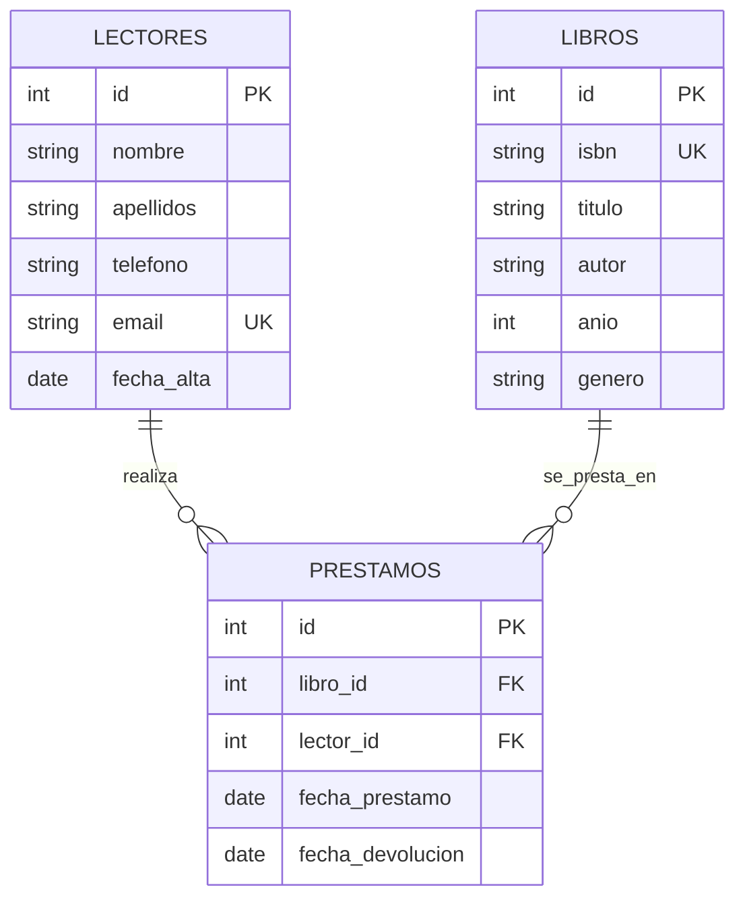

# Biblioteca municipal: base de datos y consultas

Guía de referencia del modelo de datos y las consultas SQL de la aplicación. Puede servir como punto de partida para adaptar el esquema a otro proyecto de biblioteca.

## Tecnología y reglas del modelo

- Base de datos MySQL o MariaDB, usando tablas InnoDB y caracteres UTF-8 (`utf8mb4`).
- PHP accede a la base de datos mediante PDO y consultas preparadas.
- `prestamos.fecha_devolucion IS NULL` indica que el préstamo sigue activo.
- El vencimiento se calcula como 30 días después de `fecha_prestamo`; no se guarda en una columna aparte.
- Cada fila de `libros` representa un ejemplar prestable. El ISBN es único, por lo que este diseño no representa varias copias del mismo título.

## Diagrama de relaciones



Un lector puede tener muchos préstamos a lo largo del tiempo; cada préstamo pertenece a un lector y a un libro. Las claves foráneas impiden borrar un libro o lector que todavía tenga préstamos relacionados.

## Esquema SQL

El esquema ejecutable está en [`biblioteca-esquema.sql`](./biblioteca-esquema.sql). Su estructura esencial es:

```sql
CREATE TABLE lectores (
  id INT NOT NULL AUTO_INCREMENT PRIMARY KEY,
  nombre VARCHAR(40) NOT NULL,
  apellidos VARCHAR(60) NOT NULL,
  telefono VARCHAR(15) NOT NULL,
  email VARCHAR(100) DEFAULT NULL UNIQUE,
  fecha_alta DATE NOT NULL
) ENGINE=InnoDB DEFAULT CHARSET=utf8mb4 COLLATE=utf8mb4_spanish_ci;

CREATE TABLE libros (
  id INT NOT NULL AUTO_INCREMENT PRIMARY KEY,
  isbn VARCHAR(17) NOT NULL UNIQUE,
  titulo VARCHAR(100) NOT NULL,
  autor VARCHAR(80) NOT NULL,
  anio INT DEFAULT NULL,
  genero VARCHAR(20) NOT NULL
) ENGINE=InnoDB DEFAULT CHARSET=utf8mb4 COLLATE=utf8mb4_spanish_ci;

CREATE TABLE prestamos (
  id INT NOT NULL AUTO_INCREMENT PRIMARY KEY,
  libro_id INT NOT NULL,
  lector_id INT NOT NULL,
  fecha_prestamo DATE NOT NULL DEFAULT CURRENT_TIMESTAMP,
  fecha_devolucion DATE DEFAULT NULL,
  KEY libro_id (libro_id),
  KEY lector_id (lector_id),
  CONSTRAINT prestamos_ibfk_1 FOREIGN KEY (libro_id) REFERENCES libros (id),
  CONSTRAINT prestamos_ibfk_2 FOREIGN KEY (lector_id) REFERENCES lectores (id)
) ENGINE=InnoDB DEFAULT CHARSET=utf8mb4 COLLATE=utf8mb4_spanish_ci;
```

## Consultas principales

Las consultas de producción están encapsuladas como funciones en [`modelo.php`](./modelo.php). Los `?` son parámetros preparados por PDO; no se deben sustituir concatenando datos recibidos del usuario.

### Préstamos activos, vencimiento y retraso

```sql
SELECT p.id, l.titulo,
       le.id AS lector_id, le.nombre, le.apellidos,
       p.fecha_prestamo,
       DATE_ADD(p.fecha_prestamo, INTERVAL 30 DAY) AS fecha_vencimiento,
       GREATEST(
         DATEDIFF(CURDATE(), DATE_ADD(p.fecha_prestamo, INTERVAL 30 DAY)),
         0
       ) AS dias_retraso
FROM prestamos p
JOIN libros l ON l.id = p.libro_id
JOIN lectores le ON le.id = p.lector_id
WHERE p.fecha_devolucion IS NULL
ORDER BY p.fecha_prestamo;
```

### Libros disponibles

```sql
SELECT l.id, l.titulo, l.autor
FROM libros l
WHERE NOT EXISTS (
  SELECT 1
  FROM prestamos p
  WHERE p.libro_id = l.id AND p.fecha_devolucion IS NULL
)
ORDER BY l.titulo;
```

### Buscar y filtrar libros

La aplicación permite buscar por título o autor y combinar la búsqueda con género y disponibilidad. Los filtros se añaden condicionalmente en PHP:

```sql
SELECT l.id, l.isbn, l.titulo, l.autor, l.anio, l.genero,
       CASE WHEN EXISTS (
         SELECT 1
         FROM prestamos p
         WHERE p.libro_id = l.id AND p.fecha_devolucion IS NULL
       ) THEN 'Prestado' ELSE 'Disponible' END AS estado
FROM libros l
WHERE (l.titulo LIKE ? OR l.autor LIKE ?)
  AND l.genero = ?
ORDER BY l.titulo;
```

Para filtrar por disponibilidad se usa `EXISTS` si se buscan libros prestados y `NOT EXISTS` si se buscan disponibles. Cada filtro opcional se agrega a la cláusula `WHERE` con sus propios parámetros preparados.

### Registrar un préstamo

El préstamo se hace dentro de una transacción para evitar que dos operaciones simultáneas presten el mismo ejemplar:

```sql
START TRANSACTION;

SELECT id FROM libros WHERE id = ? FOR UPDATE;

SELECT COUNT(*)
FROM prestamos
WHERE libro_id = ? AND fecha_devolucion IS NULL;

-- Solo si el recuento es cero:
INSERT INTO prestamos (libro_id, lector_id, fecha_prestamo)
VALUES (?, ?, CURDATE());

COMMIT;
```

Si el recuento es mayor que cero, se cancela con `ROLLBACK`. Si ocurre un error, también debe revertirse la transacción.

### Registrar una devolución

```sql
UPDATE prestamos
SET fecha_devolucion = CURDATE()
WHERE id = ? AND fecha_devolucion IS NULL;
```

El número de filas afectadas indica si se devolvió un préstamo activo.

### Lectores

```sql
-- Listar
SELECT id, nombre, apellidos, telefono, email, fecha_alta
FROM lectores
ORDER BY apellidos, nombre;

-- Consultar por id
SELECT id, nombre, apellidos, telefono, email, fecha_alta
FROM lectores
WHERE id = ?;

-- Crear
INSERT INTO lectores (nombre, apellidos, telefono, email, fecha_alta)
VALUES (?, ?, ?, ?, CURDATE());

-- Actualizar
UPDATE lectores
SET nombre = ?, apellidos = ?, telefono = ?, email = ?
WHERE id = ?;

-- Eliminar (la FK lo impide si tiene préstamos asociados)
DELETE FROM lectores WHERE id = ?;
```

El historial de préstamos de un lector une `prestamos` con `libros` por `libro_id` y filtra por `lector_id`.

### Libros

```sql
-- Consultar por id
SELECT id, isbn, titulo, autor, anio, genero
FROM libros
WHERE id = ?;

-- Crear
INSERT INTO libros (isbn, titulo, autor, anio, genero)
VALUES (?, ?, ?, ?, ?);

-- Actualizar
UPDATE libros
SET isbn = ?, titulo = ?, autor = ?, anio = ?, genero = ?
WHERE id = ?;

-- Eliminar (la FK lo impide si tiene préstamos asociados)
DELETE FROM libros WHERE id = ?;

-- Géneros para los filtros del catálogo
SELECT DISTINCT genero
FROM libros
WHERE genero <> ''
ORDER BY genero;
```

## Funciones del modelo PHP

| Función | Propósito |
|---|---|
| `prestamosEnCurso()` | Lista préstamos activos, fecha de vencimiento y días de retraso. |
| `librosDisponibles()` | Devuelve ejemplares sin préstamo activo. |
| `prestar()` | Comprueba disponibilidad y registra el préstamo en una transacción. |
| `devolverPrestamo()` | Marca un préstamo activo como devuelto. |
| `buscarLibros()` | Busca por texto y combina filtros de género y estado. |
| `generosLibros()` | Devuelve los géneros disponibles para el filtro. |
| `listaLectores()` / `lectorPorId()` | Lista o consulta lectores. |
| `prestamosDeLector()` | Muestra el historial de un lector. |
| `crearLector()` / `actualizarLector()` / `eliminarLector()` | Operaciones de mantenimiento de lectores. |
| `libroPorId()` | Consulta un libro por id. |
| `crearLibro()` / `actualizarLibro()` / `eliminarLibro()` | Operaciones de mantenimiento de libros. |
| `totalLibros()` | Cuenta los libros registrados. |

## Adaptación a otro proyecto

- Para admitir varias copias por título, separa `titulos` de `ejemplares`: conserva el ISBN único en el título y crea una fila por copia; los préstamos deben apuntar al id del ejemplar.
- Para plazos distintos, guarda la fecha de vencimiento en `prestamos` en vez de calcular siempre 30 días.
- Para otros motores, adapta las funciones MySQL `DATE_ADD`, `DATEDIFF`, `CURDATE`, el bloqueo `FOR UPDATE`, `AUTO_INCREMENT`, `ENGINE` y las colaciones.
- Mantén las operaciones con parámetros preparados y las altas/bajas relacionadas dentro de transacciones cuando sea necesario.

## Crear aplicaciones nuevas: cuentas y acceso

En esta aplicación, la tabla `usuarios` es la fuente de verdad de la cuenta administradora. El nombre de usuario no es necesariamente `root`: ese texto es solo el usuario de MySQL que usa XAMPP y no debe confundirse con la cuenta de la aplicación.

Al crear una aplicación con inicio de sesión:

- Guarda la cuenta en la base de datos configurada por la aplicación y almacena la contraseña con `password_hash()`. Comprueba el acceso con `password_verify()`; nunca guardes contraseñas en texto plano ni compartas credenciales durante la depuración.
- Usa el mismo origen de datos y el mismo registro de cuenta para crearla, iniciar sesión y restablecer la contraseña. No dejes nombres predeterminados como `root` en formularios de recuperación ni dependas de valores de ejemplo ocultos.
- Muestra el nombre de la cuenta que se va a actualizar y confirma que el usuario existe antes de cambiar la contraseña. Tras guardarla, vuelve a leer el hash y verifica la contraseña antes de comunicar que la operación terminó.
- Prueba el flujo completo con la cuenta elegida: crearla, cerrar sesión, iniciar sesión, restablecer la contraseña e iniciar sesión otra vez. Verifica las redirecciones y la sesión autenticada, no solo el código HTTP o el mensaje visual.
- Si cambia el nombre de usuario, confirma que la contraseña y el formulario de restablecimiento siguen asociados a la misma cuenta. Para diagnosticar errores, compara de forma segura la base de datos, el usuario y el registro que ve PHP; nunca imprimas hashes ni contraseñas en páginas públicas.

En este proyecto el formulario local de restablecimiento identifica la cuenta administradora configurada y, al verificar el cambio, inicia la sesión. Así se evita que el proceso dependa de recordar un nombre de usuario predeterminado.
